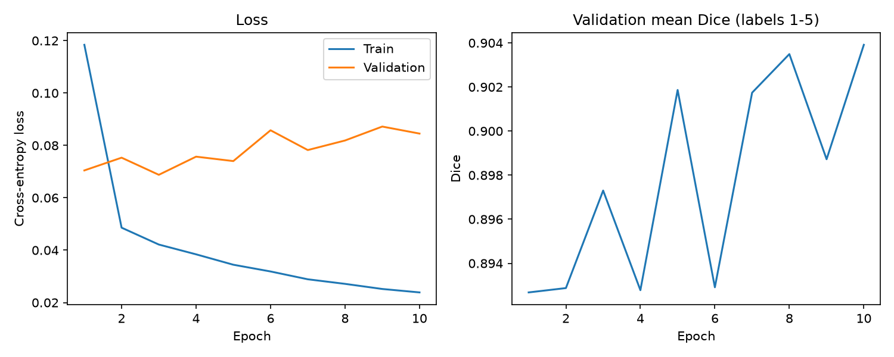

# Improved 2D U-Net for HipMRI Segmentation

**Course:** COMP3710 Pattern Recognition  
**Student ID:** s4856126  
**Difficulty:** Normal  
**Framework:** PyTorch  
**Dataset:** HipMRI Study

## 1. Introduction

Accurate medical image segmentation is important for radiotherapy planning, where clinicians must distinguish target structures from surrounding healthy tissue. In pelvic MRI, anatomical boundaries may be difficult to identify because of low soft-tissue contrast, variation between patients, and small target structures.

This project investigates whether an Improved 2D U-Net with residual convolutional blocks can provide more accurate anatomical segmentation than a standard 2D U-Net.

The central research question is whether additional architectural complexity improves segmentation accuracy, particularly around small structures and challenging boundaries, sufficiently to justify its computational cost.

A Standard U-Net is implemented as the baseline. Its performance is compared with a Residual U-Net using the same dataset partitions, training duration, optimizer, learning rate, and evaluation methodology.

The project is intended as an experimental research prototype rather than a clinically validated radiotherapy planning system.

## 2. Dataset and Preprocessing

### 2.1 Dataset

The project uses the HipMRI Study dataset provided on the University of Queensland Rangpur HPC cluster.

The 2D dataset is located at:

`/home/groups/comp3710/HipMRI_Study_open/keras_slices_data/`

Each sample consists of an MRI slice and a corresponding segmentation mask stored in NIfTI format (`.nii.gz`).

The segmentation masks contain six numerical labels, from 0 to 5. The original study includes annotations for anatomical structures such as the body outline, bone, bladder, rectum, and prostate, in addition to the background.

Visual inspection and the anatomical class information suggest that raw Label 5 may correspond to the prostate. However, the precise numerical label mapping was not explicitly available in the inspected dataset metadata. Therefore, the results are reported using raw label IDs until an authoritative mapping is established.

### 2.2 Dataset Splitting

The dataset contains the following predefined partitions:

| Partition | MRI slices | Patients |
|---|---:|---:|
| Training | 11,460 | 31 |
| Validation | 660 | 4 |
| Test | 540 | 3 |

The patient groups are disjoint across all three partitions, as verified using patient identifiers extracted from the image filenames.

Patient-level separation is essential because different MRI slices from the same patient may contain highly correlated anatomical information. Mixing slices from one patient across training and testing could artificially inflate the reported performance.

The training partition is used to optimize model parameters, the validation partition is used for checkpoint selection, and the test partition is reserved for final model evaluation.

### 2.3 Preprocessing

The preprocessing pipeline implemented in `dataset.py` includes:

1. Loading MRI slices and segmentation masks using NiBabel.
2. Matching MRI files with their corresponding segmentation masks.
3. Checking image-mask alignment, dimensionality, and label validity.
4. Resizing variable-sized slices to 256 × 128 pixels when necessary.
5. Applying bilinear interpolation to MRI images and nearest-neighbour interpolation to segmentation masks.
6. Applying per-slice Z-score intensity normalisation.
7. Converting images into floating-point PyTorch tensors and segmentation masks into integer class labels.
8. Applying random intensity augmentation to the training partition only.

Nearest-neighbour interpolation is used for masks to preserve discrete class identities. Bilinear interpolation is used for the continuous MRI intensity values.

The resulting input MRI tensor has shape `(1, 256, 128)`, while the corresponding multiclass mask has shape `(256, 128)`.

The network predicts six segmentation classes at the original preprocessed spatial resolution.

## 3. Baseline: Standard 2D U-Net

### 3.1 Architecture

The baseline is a Standard 2D U-Net implemented in `modules.py`.

The model consists of an encoder, a bottleneck, and a decoder connected by skip connections.

The encoder progressively reduces spatial resolution while learning increasingly abstract visual features. The decoder reconstructs the segmentation map using upsampling and features transferred from the corresponding encoder stages.

Skip connections preserve spatial information that might otherwise be lost during downsampling, which is especially important for segmentation boundaries.

The model uses convolutional layers, batch normalisation, ReLU activations, pooling, and upsampling operations.

It accepts a one-channel MRI image and produces six-channel segmentation logits, one channel for each raw segmentation label.

### 3.2 Training Configuration

The baseline was trained on an NVIDIA A100 GPU using the following configuration:

| Hyperparameter | Value |
|---|---|
| Epochs | 10 |
| Batch size | 8 |
| Optimizer | Adam |
| Learning rate | 0.001 |
| Loss function | Cross-Entropy Loss |
| Input channels | 1 |
| Output classes | 6 |
| Base channels | 16 |
| Input resolution | 256 × 128 |

The model was evaluated on the validation partition after each epoch.

The checkpoint with the highest foreground macro Dice was saved automatically.

### 3.3 Baseline Validation Results

The Standard U-Net completed all 10 training epochs successfully.

| Metric | Result |
|---|---:|
| Best epoch | 6 |
| Best validation foreground macro Dice | 0.9109 |
| Final training loss, Epoch 10 | 0.0265 |

The per-class validation Dice scores at the selected checkpoint were:

| Raw label | Validation Dice |
|---|---:|
| 0 | 0.9950 |
| 1 | 0.9832 |
| 2 | 0.9366 |
| 3 | 0.8995 |
| 4 | 0.8915 |
| 5 | 0.8440 |

The foreground macro Dice excludes raw Label 0, the background class.

### 3.4 Baseline Training Curves

**Figure 1.** Training and validation performance of the Standard U-Net over 10 epochs.

Validation foreground macro Dice reached its highest value of 0.9109 at Epoch 6.

Although training loss continued to decrease, validation performance fluctuated after Epoch 6, suggesting possible overfitting or training variability.

The best-performing checkpoint was therefore selected from Epoch 6 and saved as:

`checkpoints/baseline_unet.pt`

These results represent validation performance, not the independent test-set performance.

## 4. Improved 2D U-Net

### 4.1 Motivation

Although Standard U-Net provides strong baseline performance, segmenting small anatomical structures and ambiguous boundaries remains challenging.

An important limitation of deeper convolutional networks is that optimization and gradient propagation may become more difficult as network depth increases.

The proposed improvement replaces standard convolutional blocks with residual convolutional blocks while preserving the overall U-Net encoder-decoder design.

The aim is to investigate whether residual connections improve feature learning, segmentation accuracy, and boundary reliability.

### 4.2 Residual Blocks

A residual block learns a transformation of its input and adds a shortcut connection:

**y = ReLU(F(x) + S(x))**

Here:

- `F(x)` represents the transformation learned by the convolutional layers.
- `S(x)` represents the residual shortcut.
- The shortcut is an identity mapping when channel dimensions match.
- A 1 × 1 convolution is used when the input and output channel dimensions differ.

The shortcut allows features and gradients to propagate through the network more directly.

Residual connections can facilitate optimization, but improved segmentation performance must still be demonstrated experimentally.

### 4.3 Improved Architecture

The Improved U-Net is implemented in `improved_modules.py`.

Its main components include:

- Residual convolutional blocks in the encoder and decoder.
- Max pooling for spatial downsampling.
- Transposed convolutions for upsampling.
- Skip connections between corresponding encoder and decoder stages.
- A final 1 × 1 convolution producing six segmentation logits.

The architecture preserves the main spatial structure of the Standard U-Net, allowing a comparison of ordinary convolutional blocks and residual convolutional blocks.

The implementation successfully passed input-output shape tests, forward propagation tests, backward propagation tests, and optimizer smoke tests.

### 4.4 Training Configuration

The Improved U-Net was trained using:

| Hyperparameter | Value |
|---|---|
| Epochs | 10 |
| Batch size | 8 |
| Optimizer | Adam |
| Learning rate | 0.001 |
| Loss function | Cross-Entropy Loss |
| Input channels | 1 |
| Output classes | 6 |
| Base channels | 16 |
| Input resolution | 256 × 128 |

The training and validation partitions and preprocessing pipeline were identical to those used for the Standard U-Net.

The primary experimental difference was the model architecture.

### 4.5 Improved U-Net Validation Results

The Improved U-Net completed all 10 training epochs successfully on an NVIDIA A100 GPU.

The Slurm training job completed in 16 minutes and 7 seconds.

| Metric | Result |
|---|---:|
| Best epoch | 10 |
| Best validation foreground macro Dice | 0.9039 |
| Final training loss, Epoch 10 | 0.0239 |

Per-class validation Dice at Epoch 10:

| Raw label | Validation Dice |
|---|---:|
| 0 | 0.9949 |
| 1 | 0.9829 |
| 2 | 0.9362 |
| 3 | 0.8773 |
| 4 | 0.8867 |
| 5 | 0.8365 |

The best checkpoint was saved as:

`checkpoints/improved_unet.pt`

The Improved U-Net achieved a lower final training loss than the Standard U-Net, but its best validation foreground macro Dice was slightly lower.

This indicates that adding residual blocks did not produce a clear validation accuracy improvement in the current 10-epoch experiment.

However, one training run per architecture is insufficient to establish whether this difference is statistically reliable.

### 4.6 Improved U-Net Training Curves

**Figure 2.** Training and validation performance of the Improved U-Net over 10 epochs.

The Improved U-Net achieved its highest validation foreground macro Dice of 0.9039 at Epoch 10.

Although the training loss decreased steadily, validation Dice fluctuated throughout training. Compared with the Standard U-Net, the improved architecture achieved lower final training loss but slightly lower best validation Dice.

These findings suggest that residual connections did not produce a clear generalisation advantage under the current experimental configuration.

## 5. Feasibility Review

### 5.1 User Need and Project Scope

The intended user is a medical imaging specialist who may benefit from automated initial contour proposals during radiotherapy planning.

The prototype aims to segment anatomical structures from 2D pelvic MRI images, allowing a human specialist to inspect and refine predicted boundaries.

The system is designed for experimental investigation rather than autonomous clinical use.

### 5.2 Acceptance Criteria

The proposed acceptance criteria are:

1. Verify that training, validation, and test partitions contain no overlapping patients.
2. Demonstrate successful six-class MRI segmentation inference.
3. Evaluate prostate Dice against the assignment target of at least 0.75 on the held-out test set once the anatomical label mapping is verified.
4. Compare Standard U-Net and Improved U-Net using Dice, IoU, parameter count, peak GPU memory, and inference latency.
5. Analyse at least three challenging segmentation cases using ground-truth and prediction comparisons.

### 5.3 Model Choice and Course Concepts

The selected model is a 2D Residual U-Net within the Normal Difficulty category.

Its design applies core COMP3710 concepts including convolutional neural networks, hierarchical feature extraction, encoder-decoder architectures, skip connections, residual learning, loss functions, and gradient-based optimization.

A Standard 2D U-Net is used as the baseline to isolate the influence of the architectural improvement.

### 5.4 Preliminary Feasibility Evidence

The dataset loading pipeline was verified using actual HipMRI samples.

Data inspection confirmed six raw segmentation classes and patient-independent training, validation, and test partitions.

The Standard U-Net successfully completed 10 epochs and achieved a best validation foreground macro Dice of 0.9109.

The Improved U-Net subsequently completed 10 epochs and achieved a best validation foreground macro Dice of 0.9039.

Both models produced valid six-class segmentation outputs during testing.

These results demonstrate that the implementation and training pipeline are operational.

### 5.5 Risks, Computing Budget, and Fallback

Potential risks include:

- Uncertainty in the numerical anatomical label mapping.
- Severe class imbalance involving smaller target structures.
- Overfitting due to limited patient diversity.
- Segmentation errors near ambiguous anatomical boundaries.
- Additional computational cost from residual blocks.
- Limited evidence from single-run experiments.

Training jobs were submitted through the Rangpur Slurm scheduler with an NVIDIA A100 GPU.

The improved-model training job completed in 16 minutes and 7 seconds, within its allocated three-hour runtime limit.

If the improved architecture fails to demonstrate meaningful performance gains, the trained Standard U-Net remains an appropriate baseline and potential fallback.

**Compulsory practical check-off status:** To be confirmed against the tutor's completion record. Including this review in the README does not replace the required consultation.

## 6. Experimental Comparison

### 6.1 Validation Performance

The two models were trained for 10 epochs using the same data partitions and principal training hyperparameters.

| Metric | Standard U-Net | Improved U-Net |
|---|---:|---:|
| Training epochs | 10 | 10 |
| Best validation epoch | 6 | 10 |
| Best validation foreground macro Dice | **0.9109** | 0.9039 |
| Label 5 validation Dice at selected checkpoint | **0.8440** | 0.8365 |
| Final training loss | 0.0265 | **0.0239** |

The Standard U-Net achieved approximately 0.0070 higher validation foreground macro Dice.

For raw Label 5, the Standard U-Net achieved approximately 0.0075 higher Dice at its selected checkpoint.

Although Improved U-Net produced lower training loss, it did not outperform the baseline on the selected validation accuracy metrics.

This suggests that the additional residual structure did not provide a measurable advantage in this experiment.

Potential explanations include different optimization dynamics, limited training diversity, architecture-specific inductive biases, and ordinary random variation between training runs.

The conclusion remains preliminary until the independent test-set comparison is complete.

### 6.2 Independent Test Set Evaluation

The independent test partition contains 540 MRI slices from three patients.

Both trained models will be evaluated on the same test partition using the shared `evaluate.py` script.

This evaluation calculates per-class Dice and Intersection-over-Union (IoU) by accumulating confusion counts over the evaluation dataset.

This aggregation method must be distinguished from alternative methods such as averaging per-slice Dice values.

**Test evaluation status:** Submitted to Rangpur; final results pending.

| Metric | Standard U-Net | Improved U-Net |
|---|---|---|
| Test foreground macro Dice | TODO | TODO |
| Test Label 5 Dice | TODO | TODO |
| Test Label 5 IoU | TODO | TODO |
| Mean inference time per image | TODO | TODO |
| Peak allocated GPU memory | TODO | TODO |
| Trainable parameters | TODO | TODO |

The test results will be reported only after the corresponding GPU evaluation job has completed successfully.

Raw Label 5 results will not be described as confirmed prostate-specific results until the anatomical mapping is verified.

### 6.3 Resource Efficiency

Besides segmentation accuracy, practical deployment requires consideration of computational cost.

The comparison will include model parameter count, inference latency, and peak GPU memory allocation under a consistent test configuration.

A more complex model should be preferred only if its performance improvements justify the additional resource requirements.

Measurements from `evaluate.py` will provide an initial technical comparison. Inference time measurements should be interpreted with consideration of hardware, batch size, and measurement methodology.

## 7. Qualitative Failure Case Analysis

Global Dice scores may hide local segmentation errors, especially in small structures and difficult boundary regions.

The `failure_cases.py` script compares both models on identical MRI slices and identifies informative cases according to their segmentation errors.

The analysis records:

- Dice for the selected raw label on individual slices.
- Differences between Standard and Improved U-Net predictions.
- False-positive segmentation pixels.
- False-negative segmentation pixels.
- Cases where either model has particularly low segmentation accuracy.

The intended analysis includes approximately five representative test cases selected from actual model predictions.

For each case, the analysis will investigate whether errors are associated with small target size, weak image contrast, uncertain boundaries, or disagreement between the two architectures.

**Failure-case image generation and case-specific interpretation:** TODO, pending completion and inspection of the analysis outputs.

Patient-level MRI images and derived overlays will not be publicly redistributed without confirming the applicable data-sharing permissions.

## 8. Usage and Reproducibility

### 8.1 Project Structure

| File | Purpose |
|---|---|
| `dataset.py` | Data loading, preprocessing, augmentation, and split verification |
| `modules.py` | Standard U-Net architecture |
| `improved_modules.py` | Improved Residual U-Net architecture |
| `train.py` | Baseline training and validation |
| `train_improved.py` | Improved-model training using the shared pipeline |
| `predict.py` | Segmentation inference and visualisation |
| `evaluate.py` | Dataset-level Dice, IoU, and resource evaluation |
| `failure_cases.py` | Failure-case selection and visual analysis |
| `README.md` | Project documentation and experimental report |

### 8.2 Software Environment

The experiments were conducted using the University of Queensland Rangpur HPC environment.

The verified software versions are:

| Software | Version |
|---|---|
| Python | 3.11.13 |
| PyTorch | 2.14.1+cu130 |
| NumPy | 2.4.6 |
| NiBabel | 5.4.2 |
| Matplotlib | 3.11.2 |

GPU training was performed using NVIDIA A100 hardware.

The original dataset is stored on Rangpur and is not included in the repository.

### 8.3 Training

The Standard U-Net can be trained using:

`python train.py --epochs 10 --batch-size 8 --device cuda --checkpoint checkpoints/baseline_unet.pt --output-dir outputs/baseline_10epochs`

The Improved U-Net can be trained using:

`python train_improved.py --epochs 10 --batch-size 8 --device cuda --checkpoint checkpoints/improved_unet.pt --output-dir outputs/improved_10epochs`

These GPU commands should be executed within an appropriately allocated Rangpur GPU job rather than directly on the login node.

The training scripts save model checkpoints and training histories.

### 8.4 Prediction

Example baseline inference:

`python predict.py --model baseline --index 0`

Example improved-model inference:

`python predict.py --model improved --index 0`

The prediction script loads the selected trained checkpoint, generates a segmentation prediction, and saves a visual comparison.

### 8.5 Evaluation

A lightweight evaluation functionality check can be run using:

`python evaluate.py --model baseline --split validate --device cpu --max-samples 2`

This command evaluates only two validation slices and does not produce a representative accuracy benchmark.

Full test-set evaluation can be performed with:

`python evaluate.py --model baseline --split test --device cuda --batch-size 8`

`python evaluate.py --model improved --split test --device cuda --batch-size 8`

The evaluation script saves numerical results as CSV and JSON files.

### 8.6 Reproducibility Notes

Model selection is performed using validation performance rather than test-set performance.

The same predefined data partitions are retained for both architectures.

Model checkpoints, full training data, and generated outputs are stored separately from the source-code repository.

Reported numerical performance is based on actual model training and evaluation logs rather than synthetic or illustrative values.

A single experimental run does not quantify variance across random seeds. More extensive repeat experiments would be necessary to determine the statistical robustness of any observed performance difference.

## 9. Engineering Recommendation

### 9.1 Preliminary Recommendation

Based on the completed validation experiments, the Standard U-Net currently provides a slightly stronger segmentation benchmark than the Improved U-Net.

The baseline achieved a validation foreground macro Dice of 0.9109, compared with 0.9039 for the residual architecture.

This suggests that additional architectural complexity does not automatically improve segmentation quality.

The Improved U-Net achieved lower training loss, but that reduction did not translate into better validation Dice.

### 9.2 Deployment Considerations

For an annotation-assistance workflow, model selection should consider not only average segmentation accuracy but also boundary reliability, small-structure performance, inference speed, and GPU resource requirements.

The models have not been clinically validated, and high global Dice alone is insufficient evidence for safe autonomous radiotherapy contouring.

### 9.3 Final Recommendation

**Pending:** Complete the independent test-set comparison and inspect representative segmentation failures before making the final recommendation.

If the Improved U-Net does not offer clinically relevant accuracy improvements and requires additional computational resources, the Standard U-Net would be the more efficient choice for further research.

If the improved architecture provides better performance on important difficult cases, the extra cost may be justified despite a slightly lower global validation Dice.

The final recommendation will be based on the measured trade-off rather than architectural complexity alone.

## 10. Artificial Intelligence Usage Disclosure

ChatGPT was used to assist with understanding PyTorch concepts, developing and debugging data-loading and model-training code, preparing evaluation and visualisation scripts, interpreting diagnostic outputs, and structuring the project documentation.

AI assistance included suggestions for implementing residual blocks, structuring reproducible experiments, and identifying potential problems involving medical image preprocessing, data leakage, and model evaluation.

The suggested code was checked through dataset audits, patient-split verification, tensor shape tests, forward and backward propagation smoke tests, checkpoint inspection, and actual model training experiments on Rangpur.

Both models completed 10-epoch training runs, and saved checkpoints were inspected to confirm successful model selection.

Final evaluation and visual error analysis are being performed using actual HipMRI data.

The author remains responsible for validating the implementation, experimental claims, and conclusions. Unverified anatomical mappings and incomplete experiments are explicitly identified.

## 11. Data Acknowledgment and Usage Restrictions

### 11.1 Acknowledgment

Data were provided in part by the HipMRI Study.

The HipMRI Study dataset was used for non-commercial academic research as part of the COMP3710 Pattern Recognition project at the University of Queensland.

The contributions of the dataset creators and the researchers responsible for MRI acquisition and anatomical segmentation are acknowledged.

### 11.2 Data Usage Restrictions

The project follows the HipMRI Study data use agreement.

The agreement prohibits commercial use of the dataset and attempts to identify or contact the included human participants.

The dataset is used only for educational and non-commercial research purposes.

The original MRI scans, segmentation masks, and trained model checkpoints are not distributed through this GitHub repository.

Public redistribution of patient-level MRI visualisations or derived overlays will only be considered after confirming the applicable permissions.

The dataset providers do not guarantee the correctness of the provided data. Therefore, preprocessing assumptions, annotation quality, and anatomical label mappings must be independently checked where possible.

### 11.3 Dataset Citation

HipMRI Study for MRI-alone treatment planning and other imaging.

https://doi.org/10.1016/j.ijrobp.2015.08.045

This publication is included among the references specified in the HipMRI Study data use agreement.

## 12. References

1. The University of Queensland. *COMP3710/COMP7710 Pattern Recognition: Report Assessment Specification*. 2026.

2. HipMRI Study. *HipMRI Study for MRI-alone Treatment Planning and Other Imaging*. https://doi.org/10.1016/j.ijrobp.2015.08.045

3. Ronneberger, O., Fischer, P., and Brox, T. (2015). *U-Net: Convolutional Networks for Biomedical Image Segmentation*. arXiv:1505.04597. https://arxiv.org/abs/1505.04597

4. He, K., Zhang, X., Ren, S., and Sun, J. (2016). *Deep Residual Learning for Image Recognition*. Proceedings of the IEEE Conference on Computer Vision and Pattern Recognition. https://arxiv.org/abs/1512.03385

5. HipMRI Study. *Data Use Agreement*. Distributed with the HipMRI Study dataset on the UQ Rangpur HPC cluster.
