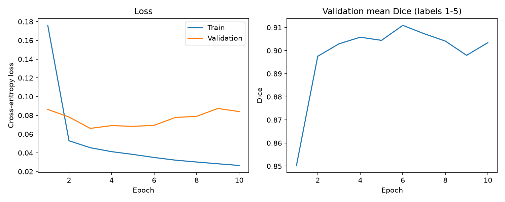

# Improved 2D U-Net for HipMRI Segmentation

**Course:** COMP3710 Pattern Recognition  
**Student ID:** s4856126  
**Difficulty:** Normal  
**Framework:** PyTorch  
**Dataset:** HipMRI Study

## 1. Introduction

Accurate medical image segmentation is important for radiotherapy planning, where clinicians must distinguish target structures from surrounding healthy tissue. In pelvic MRI, anatomical boundaries may be difficult to identify because of low soft-tissue contrast, variation between patients, and small target structures.

This project investigates whether an Improved 2D U-Net with residual convolutional blocks can provide more accurate anatomical segmentation than a standard 2D U-Net.

The central research question is whether the additional architectural complexity improves segmentation accuracy, particularly around small structures and challenging boundaries, sufficiently to justify its computational cost.

A Standard U-Net is implemented as the baseline. Its performance is compared with a Residual U-Net using the same dataset, patient split, training settings, and evaluation methodology.

## 2. Dataset and Preprocessing

### 2.1 Dataset

The project uses the HipMRI Study dataset provided on the University of Queensland Rangpur HPC cluster.

The 2D dataset is located at:

`/home/groups/comp3710/HipMRI_Study_open/keras_slices_data/`

Each sample consists of an MRI slice and a corresponding segmentation mask stored in NIfTI format (`.nii.gz`).

The segmentation masks contain six numerical labels, from 0 to 5. These labels represent the background and annotated anatomical regions.

The precise anatomical correspondence of each numerical label must be verified before reporting prostate-specific performance. Raw-label metrics are reported independently of this interpretation.

### 2.2 Dataset Splitting

The dataset contains the following predefined partitions:

| Partition | MRI slices | Patients |
|---|---:|---:|
| Training | 11,460 | 31 |
| Validation | 660 | 4 |
| Test | 540 | 3 |

The patient groups are disjoint across all three partitions.

Patient-level separation is essential because different MRI slices from the same patient may contain highly correlated anatomical information. Mixing slices from one patient across training and testing could artificially inflate reported performance.

The validation partition is used for model selection, while the test partition is reserved for final evaluation.

### 2.3 Preprocessing

The preprocessing pipeline implemented in `dataset.py` includes:

1. Loading MRI slices and segmentation masks using NiBabel.
2. Matching MRI files with their corresponding segmentation masks.
3. Resizing variable-sized slices to 256 × 128 pixels when required.
4. Applying bilinear interpolation to MRI images and nearest-neighbour interpolation to segmentation masks.
5. Applying per-slice Z-score intensity normalisation.
6. Converting MRI images into floating-point PyTorch tensors and segmentation masks into integer class labels.
7. Applying intensity augmentation to the training partition only.

Nearest-neighbour interpolation is used for segmentation masks to preserve discrete class identities.

The resulting MRI tensor has shape `(1, 256, 128)`, while each multiclass mask has shape `(256, 128)`.

## 3. Baseline: Standard 2D U-Net

### 3.1 Architecture

The baseline is a Standard 2D U-Net implemented in `modules.py`.

It consists of an encoder, a bottleneck, and a decoder with skip connections.

The encoder progressively reduces spatial resolution while learning increasingly abstract features. The decoder reconstructs the segmentation map using upsampling and features transferred from the encoder.

Skip connections help preserve spatial information that might otherwise be lost during downsampling.

The model accepts one-channel MRI images and produces six-channel segmentation logits.

### 3.2 Training Configuration

The baseline was trained on an NVIDIA A100 GPU using the following settings:

| Hyperparameter | Value |
|---|---|
| Epochs | 10 |
| Batch size | 8 |
| Optimizer | Adam |
| Learning rate | 0.001 |
| Loss function | Cross-Entropy Loss |
| Input channels | 1 |
| Output classes | 6 |
| Base channels | 16 |
| Input size | 256 × 128 |

The model checkpoint with the highest validation foreground macro Dice was saved automatically.

### 3.3 Baseline Validation Results

The complete 10-epoch experiment finished successfully.

| Metric | Result |
|---|---:|
| Best epoch | 6 |
| Best validation foreground macro Dice | 0.9109 |
| Final training loss, Epoch 10 | 0.0265 |

The per-class validation Dice scores at the selected checkpoint were:

| Raw label | Dice |
|---|---:|
| 0 | 0.9950 |
| 1 | 0.9832 |
| 2 | 0.9366 |
| 3 | 0.8995 |
| 4 | 0.8915 |
| 5 | 0.8440 |

### Baseline Training Curves

**Figure 1.** Training and validation performance of the
Standard U-Net over 10 epochs.

The validation foreground macro Dice reached its highest
value of 0.9109 at Epoch 6. Although training loss continued
to decrease, validation performance fluctuated after Epoch 6,
suggesting possible overfitting.

Therefore, the checkpoint from Epoch 6 was selected for
subsequent evaluation.

The foreground macro Dice excludes the background class.

The validation Dice peaked at Epoch 6 and fluctuated afterward, even though training loss continued to decrease. This suggests possible overfitting during later epochs.

The best-performing checkpoint was saved as `checkpoints/baseline_unet.pt`.

**Important:** These values are validation results, not final test-set results. The anatomical identity of raw Label 5 is still being verified.

## 4. Proposed Model: Improved 2D U-Net

### 4.1 Motivation

Although the Standard U-Net provides strong baseline performance, segmentation of small anatomical structures and ambiguous boundaries remains challenging.

The proposed improvement is to replace standard convolutional blocks with residual convolutional blocks while preserving the overall U-Net encoder-decoder structure.

### 4.2 Residual Blocks

A residual block learns a transformation of its input and adds a shortcut connection:

**y = ReLU(F(x) + S(x))**

Here, `F(x)` is the learned convolutional transformation and `S(x)` is the shortcut projection, which is an identity mapping when channel dimensions match.

Residual connections can facilitate gradient propagation and help preserve features across network layers.

When the input and output channel counts differ, a 1 × 1 convolution is used to match their dimensions.

### 4.3 Improved Architecture

The Improved U-Net implemented in `improved_modules.py` uses:

- Residual convolutional blocks in the encoder and decoder.
- Max pooling for spatial downsampling.
- Transposed convolutions for upsampling.
- U-Net skip connections between corresponding encoder and decoder stages.
- A final 1 × 1 convolution producing six segmentation channels.

The implementation successfully passed forward propagation and training smoke tests.

The improved model will be trained with the same 10-epoch configuration as the baseline. This provides a controlled comparison in which the primary change is the network architecture.

## 5. Feasibility Review

**Project scope:** Develop and compare two-dimensional MRI segmentation models for automated anatomical contour proposals. The system is intended as a research prototype and not as a clinically validated autonomous planning tool.

**Acceptance criteria:**

1. Verify that training, validation, and test partitions have no overlapping patients.
2. Demonstrate successful six-class segmentation inference on MRI slices.
3. Evaluate prostate Dice against the assignment target of at least 0.75 on the independent test set, once the label mapping is verified.
4. Compare the baseline and improved models using Dice, IoU, parameter count, peak GPU memory, and inference latency.
5. Investigate at least three difficult segmentation cases with ground-truth and prediction overlays.

**Preliminary feasibility evidence:** Data loading and patient separation checks were completed successfully. The Standard U-Net achieved a best validation foreground macro Dice of 0.9109 after 10 epochs, demonstrating that the dataset and training pipeline are operational.

**Risks and constraints:** Important risks include label-mapping uncertainty, class imbalance, overfitting, limited patient diversity, and increased computational cost. GPU training is performed through Rangpur Slurm jobs with an allocated runtime budget of up to three hours per submitted experiment.

**Fallback:** If the Improved U-Net fails to improve accuracy or requires disproportionate resources, the existing trained Standard U-Net remains a functional baseline.

**Practical check-off status:** TODO: Confirm whether the compulsory feasibility consultation has been completed and incorporate any relevant tutor feedback.

## 6. Experimental Comparison

TODO: Complete after Improved U-Net training and full evaluation.

The comparison will cover:

- Per-class Dice and IoU on the held-out test set.
- Validation performance and training curves.
- Model parameter count.
- Peak GPU memory usage.
- Inference latency.
- Differences in failure patterns between architectures.

Metrics produced by different aggregation methods will be identified explicitly rather than treated as directly interchangeable.

## 7. Qualitative Failure Case Analysis

TODO: Include 3–5 actual cases from the held-out test dataset.

For each case, present the original MRI, ground-truth mask, predicted mask, and an overlay highlighting false-positive and false-negative regions.

The analysis will focus on small target structures, difficult boundaries, missing predictions, and anatomically inconsistent segmentation regions.

## 8. Usage and Reproducibility

The implementation includes:

| File | Purpose |
|---|---|
| `dataset.py` | Data loading, preprocessing, and augmentation |
| `modules.py` | Standard U-Net architecture |
| `improved_modules.py` | Improved Residual U-Net architecture |
| `train.py` | Baseline training and validation |
| `train_improved.py` | Improved model training using the shared pipeline |
| `predict.py` | Segmentation inference and visualisation |
| `evaluate.py` | Dice, IoU, and inference resource evaluation |

**Example inference:**

`python predict.py --model baseline --index 0`

**Example validation evaluation:**

`python evaluate.py --model baseline --split validate --device cpu --max-samples 2`

The second command is a partial functionality check, not a complete benchmark.

**Dependencies:** Python, PyTorch, NumPy, NiBabel, and Matplotlib.

### Software Environment

The experiments were conducted on the UQ Rangpur HPC cluster.

The verified software versions are:

| Software | Version |
|---|---|
| Python | 3.11.13 |
| PyTorch | 2.14.1+cu130 |
| NumPy | 2.4.6 |
| NiBabel | 5.4.2 |
| Matplotlib | 3.11.2 |

GPU training was performed using an NVIDIA A100 GPU.

The dataset is stored on Rangpur and is not included
in the GitHub repository.

Model checkpoints and the original medical imaging dataset are not included in the Git repository.

## 9. Engineering Recommendation

TODO: Write an evidence-based recommendation after the complete model comparison.

The recommendation should distinguish global segmentation accuracy from local anatomical reliability and explain whether improvements justify the additional computational cost.

## 10. Artificial Intelligence Usage Disclosure

ChatGPT was used to assist with understanding PyTorch concepts, drafting and debugging model and data-loading code, preparing training and evaluation scripts, interpreting diagnostic outputs, and structuring this report.

The generated code and suggestions were checked through dataset audits, patient-split verification, model shape tests, forward and backward propagation smoke tests, checkpoint inspection, and actual training experiments on Rangpur.

Further validation will include independent test-set evaluation and visual inspection of segmentation failures.

All results presented as experimental findings must be supported by actual program outputs. Unverified anatomical mappings and incomplete experiments are identified explicitly.

## 11. References

- COMP3710/COMP7710 Pattern Recognition, 2026 Report Assessment Specification.
- HipMRI Study dataset, provided through UQ Rangpur.
- TODO: Add the original U-Net, residual learning, and Improved U-Net research references used in the final implementation.
