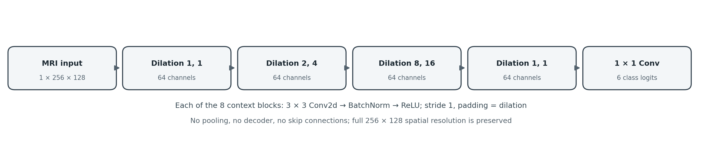
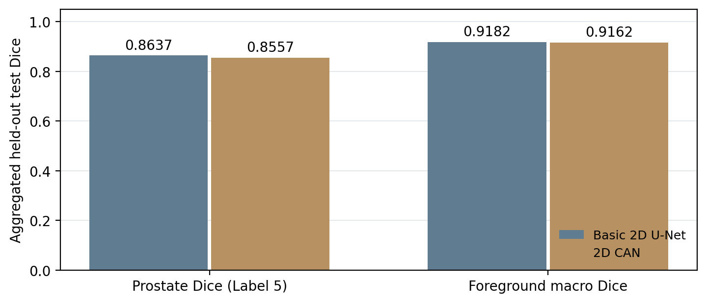
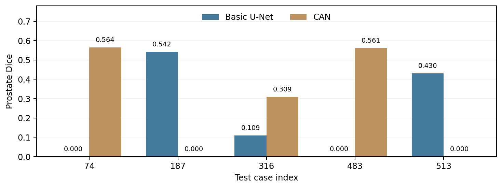
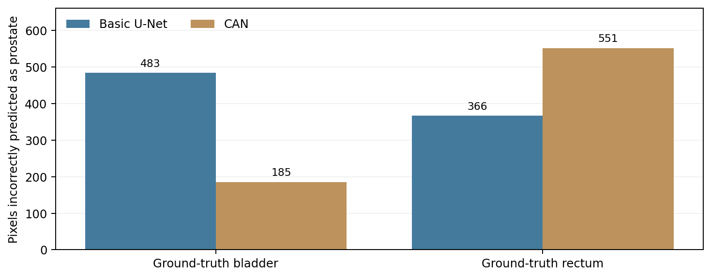

# Basic 2D U-Net vs. 2D Context Aggregation Network (CAN) for HipMRI Segmentation

**Course:** COMP3710 Pattern Recognition  
**Student ID:** 48561268  
**Difficulty:** Normal (HipMRI 2D CAN)  
**Framework:** PyTorch  
**Dataset:** HipMRI Study  
**Status:** Training, independent test benchmarking on 540 held-out slices, five-case failure analysis, and full-test-set bladder/rectum-to-prostate leakage analysis completed. Five selected error-map figures were visually inspected. The results are not clinical validation; patient-level MRI figures and analysis CSVs are not authorised for public redistribution without permission.

## 1. Introduction

Accurate medical image segmentation can support radiotherapy planning by helping specialists review anatomical contours. Pelvic MRI segmentation remains difficult around low-contrast tissue interfaces, small target regions and variable anatomy. A high global Dice score may conceal a complete miss on an individual slice.

**Engineering dilemma:** Does adding multi-scale spatial context through dilated convolutions improve prostate segmentation and difficult-boundary reliability compared with a standard 2D U-Net, and is the resulting accuracy/resource trade-off appropriate for a human-in-the-loop annotation tool?

This project implements a **Basic 2D U-Net baseline** and a **2D Context Aggregation Network (CAN)**, the latter selected from the Normal Difficulty segmentation options. Both models operate on the same HipMRI 2D slices, use the same patient-disjoint train/validation/test partitions and principal training settings, and are assessed on the complete held-out test set. CAN explores wider *in-plane* spatial context without a pooling-based encoder-decoder. It does **not** incorporate adjacent slices or full 3D continuity.

The primary outcome is not that CAN must outperform the baseline. Instead, the purpose is to measure whether its design provides enough benefit in segmentation accuracy, local error behaviour and resource efficiency to justify its use. In addition to overall Dice/IoU and five illustrative error cases, the completed analysis measures how often pixels annotated as **bladder** or **rectum** are incorrectly predicted as **prostate** across the full test set. Neither network is a clinically validated system, and all predictions would require review by an imaging specialist.

## 2. Dataset and Preprocessing

### 2.1 Dataset

The project uses the HipMRI Study dataset provided on the University of Queensland Rangpur HPC cluster.

The 2D dataset is located at:

`/home/groups/comp3710/HipMRI_Study_open/keras_slices_data/`

Each sample consists of an MRI slice and a corresponding segmentation mask stored in NIfTI format (`.nii.gz`).

The segmentation masks contain six numerical labels, from 0 to 5. The official HipMRI Study supporting file, `BriefDataDescription.txt` (CSIRO), defines the following anatomical mapping:

| Raw label | Anatomical structure |
|---|---|
| 0 | Background |
| 1 | Body |
| 2 | Bones |
| 3 | Bladder |
| 4 | Rectum |
| **5** | **Prostate** |

The original 3D semantic mask `B040_Week0_SEMANTIC.nii.gz` was also compared with the preprocessed 2D mask `seg_040_week_0_slice_24.nii.gz`. After selecting the corresponding original slice and accounting for image orientation, foreground label values agreed exactly in this checked example (label agreement = 1.0). This verifies preservation of the numerical labels for the checked pair; it is not an exhaustive verification of every slice. Together with the official class definitions, the evidence supports reporting raw Label 5 as the prostate. The dataset description can be found via the CSIRO HipMRI Study collection (see References).

### 2.2 Dataset Splitting

The dataset contains the following predefined partitions:

| Partition | MRI slices | Patients |
|---|---:|---:|
| Training | 11,460 | 31 |
| Validation | 660 | 4 |
| Test | 540 | 3 |

The patient groups are disjoint across all three partitions, as verified using patient identifiers extracted from image filenames.

Patient-level separation is essential because different MRI slices from the same patient may contain highly correlated anatomical information. Mixing slices from one patient across training and testing could artificially inflate reported performance.

The training partition is used to optimize model parameters, the validation partition is used for checkpoint selection, and the test partition is reserved for final evaluation.

### 2.3 Preprocessing

The preprocessing pipeline implemented in `dataset.py` includes:

1. Loading MRI slices and segmentation masks using NiBabel.
2. Matching MRI files with their corresponding segmentation masks.
3. Checking image-mask alignment, dimensionality, and label validity.
4. Standardizing image dimensions to 256 × 128 pixels when necessary.
5. Using bilinear interpolation for MRI images and nearest-neighbour interpolation for segmentation masks.
6. Applying per-slice Z-score intensity normalisation.
7. Converting MRI images into floating-point PyTorch tensors.
8. Converting segmentation masks into integer class labels.
9. Applying random intensity augmentation to the training partition only.

Nearest-neighbour interpolation preserves valid integer class identities in segmentation masks, while bilinear interpolation is appropriate for continuous MRI intensity values.

The resulting input MRI tensor has shape `(1, 256, 128)`, while the corresponding multiclass mask has shape `(256, 128)`.

**Mask encoding:** While the project specification mentions one-hot masks, this implementation correctly passes integer class-index masks (`0`–`5`) to PyTorch `CrossEntropyLoss`, with logits shaped `(N, 6, H, W)` and target masks shaped `(N, H, W)`. One-hot conversion is not necessary for this loss; nearest-neighbour resampling preserves class indices.

The network predicts six segmentation classes at the preprocessed input resolution.

## 3. Baseline: Standard 2D U-Net

### 3.1 Architecture

The baseline is a Standard 2D U-Net implemented in `modules.py`.

The model consists of an encoder, a bottleneck, and a decoder connected by skip connections.

The encoder progressively reduces spatial resolution while learning increasingly abstract visual features. The decoder reconstructs the segmentation map using upsampling and features transferred from corresponding encoder stages.

Skip connections preserve spatial information that might otherwise be lost during downsampling, which is especially important for segmentation boundaries.

The model uses convolutional layers, batch normalisation, ReLU activations, pooling, and upsampling operations.

It accepts a one-channel MRI image and produces six-channel segmentation logits.

### 3.2 Training Configuration

The baseline was trained on an NVIDIA A100 GPU using the following configuration:

| Hyperparameter | Value |
|---|---|
| Epochs | 10 |
| Batch size | 8 |
| Optimizer | Adam |
| Learning rate | 0.001 |
| Loss function | Cross-Entropy Loss |
| Input channels | 1 |
| Output classes | 6 |
| Base channels | 16 |
| Input resolution | 256 × 128 |

The model was evaluated on the validation partition after each epoch.

The checkpoint with the highest validation foreground macro Dice was saved automatically.

### 3.3 Baseline Validation Results

The Standard U-Net completed all 10 training epochs successfully.

| Metric | Result |
|---|---:|
| Best epoch | 6 |
| Best validation foreground macro Dice | 0.9109 |
| Final training loss, Epoch 10 | 0.0265 |

The per-class validation Dice scores at the selected checkpoint were:

| Raw label | Validation Dice |
|---|---:|
| 0 | 0.9950 |
| 1 | 0.9832 |
| 2 | 0.9366 |
| 3 | 0.8995 |
| 4 | 0.8915 |
| 5 | 0.8440 |

The foreground macro Dice excludes raw Label 0, the background class.

### 3.4 Baseline Training Curves


**Figure 1.** Training and validation performance of the Standard U-Net over 10 epochs.

Validation foreground macro Dice reached its highest value of 0.9109 at Epoch 6.

Although training loss continued to decrease, validation performance fluctuated after Epoch 6, suggesting possible overfitting or training variability.

The best-performing checkpoint was selected from Epoch 6 and saved as:

`checkpoints/baseline_unet.pt`

These results represent validation performance rather than independent test-set performance.

## 4. Proposed Architecture: 2D CAN

### 4.1 Motivation and Course Concepts

Standard U-Net increases effective receptive field using successive convolutions and downsampling, then recovers spatial resolution through upsampling and skip connections. While effective, downsampling may discard fine location information that matters for small structures and uncertain boundaries.

**Context Aggregation Network (CAN)** explores a different design: successive convolutions with increasing *dilation rates* gather information from wider in-plane neighbourhoods while retaining the original feature-map height and width. The approach is related to the multi-scale context aggregation method described by Yu and Koltun (2016), referenced in the COMP3710 assessment specification.

A 3 × 3 convolution with dilation `d` has an effective kernel coverage of `(2d + 1) × (2d + 1)` input positions, although only nine kernel sample positions are used. Thus dilation rates 1, 2, 4, 8 and 16 correspond individually to 3 × 3, 5 × 5, 9 × 9, 17 × 17 and 33 × 33 coverage. Stacking dilated layers further grows the network's theoretical receptive field. This increases accessible spatial context; it does not guarantee better boundary prediction.

### 4.2 Implemented Architecture

The tested `CAN2D` is implemented in `modules.py`, independently of the `UNet2D` baseline. It is a **compact course-project CAN implementation**, not a claim to reproduce every layer or setting of the published model.

| Component | Implementation |
|---|---|
| Input | One MRI channel, 256 × 128 pixels |
| Context layers | Eight successive 3 × 3 dilated convolution blocks |
| Dilation sequence | **1, 1, 2, 4, 8, 16, 1, 1** |
| Hidden width | 64 channels (`base_channels=16`, CAN-specific multiplier ×4) |
| Each block | `Conv2d` → `BatchNorm2d` → `ReLU` |
| Spatial size | Preserved by `stride=1` and `padding=dilation` |
| Pooling/decoder | No pooling, transposed-convolution decoder or U-Net skip paths |
| Output | Final 1 × 1 convolution; six raw segmentation logits |
| Trainable parameters | **260,038** |



**Figure 2.** Implemented compact 2D CAN architecture: eight dilated convolution blocks with dilation rates `1, 1, 2, 4, 8, 16, 1, 1` and a six-logit output layer. This is a schematic of the implemented model, not an MRI prediction.

For each pixel, a six-channel logit vector is predicted; `argmax` gives the final class. No sigmoid or softmax layer is inserted before the multiclass Cross-Entropy Loss. This is intentionally distinct from the earlier exploratory residual U-Net design, which is **not** the selected comparison for this report.

### 4.3 Training Configuration and Functional Checks

CAN was trained on an NVIDIA A100 using the same principal settings as the baseline:

| Hyperparameter | CAN |
|---|---|
| Training epochs | 10 |
| Batch size | 8 |
| Optimizer | Adam |
| Learning rate | 0.001 |
| Loss | Multiclass Cross-Entropy |
| Input/output channels | 1 / 6 |
| Input resolution | 256 × 128 |
| Train/validation/test partitions | 11,460 / 660 / 540 slices |
| Data preparation | Same `dataset.py` as baseline |
| Checkpoint rule | Highest **validation foreground macro Dice** |

CPU smoke tests confirmed a six-class forward pass, finite loss, backward propagation and an Adam optimisation step on a real resized HipMRI slice. Full-resolution CAN training and independent-test inference subsequently ran on Rangpur. The `train_can.py` entry point selects CAN in the shared `train.py` training pipeline; it does not overwrite the pre-existing baseline checkpoint.

### 4.4 CAN Validation Results

The 10-epoch training run completed successfully. The best checkpoint by **validation foreground macro Dice** was saved at **Epoch 8** as `checkpoints/can_best.pt`.

| Metric | Result |
|---|---:|
| Best validation epoch | **8** |
| Best validation foreground macro Dice | **0.9004** |
| Prostate validation Dice at selected checkpoint (Label 5) | **0.8290** |
| Final training loss (Epoch 10) | **0.0386** |

Per-class validation Dice at the selected Epoch 8 checkpoint:

| Raw label | Anatomical class | Validation Dice |
|---|---|---:|
| 0 | Background | 0.9926 |
| 1 | Body | 0.9826 |
| 2 | Bones | 0.9348 |
| 3 | Bladder | 0.8999 |
| 4 | Rectum | 0.8554 |
| **5** | **Prostate** | **0.8290** |

The prostate score reached 0.8311 at Epoch 9, but that checkpoint was **not** selected because the predetermined selection criterion was foreground *macro* Dice, which was lower at Epoch 9 (0.8870). This avoids changing the checkpoint rule after examining outcomes.

Training and validation histories were saved as `outputs/can/can_history.csv` and `outputs/can/can_training_curves.png` on Rangpur. The CAN training-curve image is not included in this package because its original plot was not among the available files. The observed test comparison is visualised in Figure 3.

## 5. Feasibility Review

**Project:** Basic 2D U-Net vs. 2D Context Aggregation Network for HipMRI Segmentation  
**Chosen difficulty:** Normal (2D CAN on HipMRI)  
**Intended user:** Medical imaging specialist reviewing proposed contours for prostate radiotherapy planning. This is a research prototype requiring human review, not autonomous clinical software.

### 5.1 User Need and Acceptance Criteria

**Engineering dilemma:** Does CAN's wider in-plane spatial context provide more reliable prostate and neighbouring-organ boundaries than Basic U-Net, and is the gain worth its computational cost? High dataset Dice can hide individual-slice failures.

Acceptance criteria:

1. **Data integrity:** Use patient-disjoint train/validation/test partitions and preserve alignment between MRI slices and six-class masks.
2. **Target accuracy:** CAN must achieve **prostate test Dice ≥ 0.75** on the held-out HipMRI test split.
3. **Fair comparison and resources:** Report per-class Dice/IoU for both networks on the **same test split**, plus parameter count, peak allocated GPU memory and per-image inference time.
4. **Local error evidence:** Examine **five actual difficult slices** using input/ground-truth/prediction and FP/FN maps, quantify bladder- and rectum-to-prostate label confusion, and make a practical recommendation for human review.

### 5.2 Model Choice and Course Concepts

The baseline **2D U-Net** uses convolution, pooling, decoder upsampling and skip connections to recover local detail. **2D CAN** uses eight 3 × 3 dilated-convolution blocks (rates **1, 1, 2, 4, 8, 16, 1, 1**) to aggregate wider context without downsampling. Both use six output logits and multiclass Cross-Entropy Loss. Key course concepts are receptive fields, local connectivity, pooling, dilation, segmentation, optimisation, and Dice/IoU. CAN is a compact literature-informed implementation, not an exact reproduction of Yu and Koltun (2016).

### 5.3 Feasibility Evidence

The verified patient-disjoint data split contains **11,460 training slices / 31 patients**, **660 validation slices / 4 patients**, and **540 test slices / 3 patients**. Inputs are **256 × 128** with labels **0–5**; Label 5 is prostate. Both models passed forward/backward checks and completed **10 epochs** on Rangpur A100; checkpoints were chosen by validation foreground macro Dice. On the held-out test set, **CAN achieved prostate Dice 0.8557** and Basic U-Net achieved **0.8637**. Five targeted failure cases and 540-slice bladder/rectum label-confusion counts were additionally analysed (Section 7). **No anatomically verified base/apex findings are claimed.**

### 5.4 Risks, Budget, Fallback and Check-off

Risks include small prostate targets, class imbalance, low-contrast boundaries, only three held-out patients, possible dilation sampling artefacts and missing 3D continuity. An A100 allocation of up to **three hours** was budgeted for CAN training. If CAN offers insufficient benefit, use the saved **Basic U-Net** checkpoint as the fallback and require specialist correction of suggested contours. A logical next experiment is per-patient, organ-normalised leakage analysis. The official **check-off completion status is recorded separately by the tutor** and is not asserted in this README.

## 6. Experimental Comparison

### 6.1 Validation Performance and Model Selection

Each model completed one 10-epoch training run. The predefined model-selection rule was maximum validation foreground macro Dice, excluding background Label 0.

| Metric | Basic 2D U-Net | 2D CAN |
|---|---:|---:|
| Training epochs | 10 | 10 |
| Best validation epoch | 6 | 8 |
| Best validation foreground macro Dice | **0.9109** | 0.9004 |
| Prostate validation Dice at selected checkpoint | **0.8440** | 0.8290 |
| Final training loss (Epoch 10) | **0.0265** | 0.0386 |
| Trainable parameters | 1,942,374 | **260,038** |

The baseline exceeded CAN in validation macro Dice by **0.0105**, and in prostate Dice at each model's selected checkpoint by **0.0150**. These are outcomes of single training runs, not estimates of statistically significant differences across random seeds.

### 6.2 Independent Held-out Test Evaluation

Both saved best-validation checkpoints were evaluated using the same `evaluate.py` implementation on the **complete 540-slice test partition (3 patients)**, with batch size 8 and NVIDIA A100 hardware. Metrics were computed by aggregating pixel-level confusion counts across the dataset: for each class, `Dice = 2TP / (2TP + FP + FN)` and `IoU = TP / (TP + FP + FN)`. They are **dataset-aggregated class scores**, not averages of per-slice Dice. The foreground macro Dice is the mean of Dice scores for Labels 1–5.

#### Per-class Dice and IoU

| Label and anatomy | Basic Dice | CAN Dice | Basic IoU | CAN IoU |
|---|---:|---:|---:|---:|
| 0 Background | 0.9969 | 0.9963 | 0.9939 | 0.9926 |
| 1 Body | 0.9844 | **0.9847** | 0.9693 | **0.9698** |
| 2 Bones | 0.9353 | **0.9369** | 0.8784 | **0.8813** |
| 3 Bladder | **0.9654** | 0.9638 | **0.9331** | 0.9301 |
| 4 Rectum | **0.8424** | 0.8401 | **0.7277** | 0.7243 |
| **5 Prostate** | **0.8637** | 0.8557 | **0.7600** | 0.7478 |

#### Main Results and Computational Profile

| Metric | Basic 2D U-Net | 2D CAN |
|---|---:|---:|
| Test foreground macro Dice | **0.9182** | 0.9162 |
| Test prostate Dice (Label 5) | **0.8637** | 0.8557 |
| Test prostate IoU (Label 5) | **0.7600** | 0.7478 |
| Prostate Dice ≥ 0.75 | Yes | **Yes** |
| Trainable parameters | 1,942,374 | **260,038** |
| Peak allocated CUDA memory | **149.47 MB** | 200.15 MB |
| Recorded inference time/image | 2.358 ms | 2.239 ms |



**Figure 3.** Test-set Dice comparison on the same 540 held-out MRI slices. Bars show measured dataset-aggregated scores, not averages across patients or independent training runs.

On the test partition, CAN achieved **0.8557 prostate Dice**, exceeding the assignment's **0.75** target, but was lower than the baseline's **0.8637** by approximately **0.0080 Dice (0.80 percentage points)**. The difference in foreground macro Dice was approximately **0.0020** in favour of U-Net. CAN was slightly better for Body and Bones, whereas U-Net was better for Prostate, Bladder and Rectum. Neither model is uniformly superior on every class.

The observed results do not support a claim that CAN improved *global* prostate Dice in this run. Section 7 demonstrates both improvements and regressions on selected individual slices; however, five deliberately selected cases cannot establish overall boundary reliability or clinical usability.

The evaluation produced:

- `outputs/evaluation/baseline_test_cuda.json` and `.csv`
- `outputs/evaluation/can_test_cuda.json` and `.csv`

These are numerical result files on Rangpur; source code, not the confidential medical dataset or patient-level images, should be committed to the public repository unless redistribution permission has been confirmed.

### 6.3 Resource Efficiency and Trade-offs

The CAN implementation has **260,038** trainable parameters compared with **1,942,374** for Basic U-Net, a reduction of approximately **86.6%**. The parameter count measures the number of learned weights and biases, not the memory consumption of all intermediate activations.

Despite this reduction, CAN's observed peak **allocated** CUDA memory was **200.15 MB**, versus **149.47 MB** for the baseline, an increase of approximately **33.9%**. The full-resolution dilated convolution stack retains comparatively large intermediate feature maps, which can explain how an architecture with fewer parameters consumes more allocated memory. The memory metric comes from PyTorch's CUDA allocator, not total physical VRAM reported by `nvidia-smi`.

In the same evaluation workflow, CAN's recorded time was **2.239 ms/image** versus **2.358 ms/image** for Basic U-Net, approximately **0.119 ms/image** lower. The timer included forward inference and `argmax`, with GPU synchronization, but excluded dataset loading; there was no separate repeated, warmed-up latency study. The small apparent speed advantage therefore should **not** be interpreted as a guaranteed deployment improvement.

This yields an instructive result: **parameter efficiency, allocated GPU memory and segmentation accuracy are distinct quantities**. A more compact model is not automatically more accurate, and it is not necessarily more memory-efficient during inference.

## 7. Failure Case and Anatomical Label-Confusion Analysis

### 7.1 Evaluation Method

The revised `failure_cases.py` loaded the validation-selected **Basic U-Net** (`checkpoints/baseline_unet.pt`, Epoch 6) and **CAN** (`checkpoints/can_best.pt`, Epoch 8) checkpoints and compared predictions on all **540 held-out test slices**. Case ranking considered only slices with a non-empty ground-truth prostate region (raw Label 5).

For each eligible slice, the script computed prostate Dice and recorded the number of false-positive (FP) and false-negative (FN) pixels for both networks. It selected five **distinct, deliberately challenging** cases covering CAN's lowest Dice, its largest improvement, its largest regression, the baseline's lowest Dice and a relatively larger difficult target. Selection was targeted rather than random, so these five cases **cannot estimate how often** the observed failures occur in the test population.

The script generated ten-panel figures containing the input MRI, prostate ground truth, the two binary prostate predictions, two contour comparisons and separate FP/FN overlays for each model. In contour views, red marks ground truth and green marks prediction; in error views, red is FP and blue is FN. The selected case values below come from the **actual completed CAN-vs-baseline job log**, not the earlier exploratory Residual U-Net experiment. Individual-slice Dice in this section must not be confused with the dataset-aggregated class Dice in Section 6.

### 7.2 Selected Test Cases and Pixel-Level Errors

The metrics below were obtained from `outputs/failure_cases_can/test_selected_cases.csv`, generated by the completed **Basic U-Net vs CAN** job. The two models were compared against identical ground-truth masks. **FP** is a predicted prostate pixel outside ground truth; **FN** is a ground-truth prostate pixel missed by the prediction; **TP** is their overlapping prostate pixel count. These are integer pixel counts for each individual test slice, not dataset-wide averages.

| Test index | Ground-truth pixels | Basic Dice | CAN Dice | Basic FP / FN | CAN FP / FN | CAN − Basic Dice |
|---|---:|---:|---:|---:|---:|---:|
| 513 | 148 | **0.4299** | 0.0000 | 104 / 79 | 41 / 148 | −0.4299 |
| 74 | 112 | 0.0000 | **0.5644** | 0 / 112 | 5 / 66 | +0.5644 |
| 187 | 98 | **0.5417** | 0.0000 | 7 / 59 | 0 / 98 | −0.5417 |
| 483 | 105 | 0.0000 | **0.5605** | 0 / 105 | 8 / 61 | +0.5605 |
| 316 | 104 | 0.1091 | **0.3089** | 0 / 98 | 0 / 85 | +0.1999 |



**Figure 4.** Prostate Dice for the five deliberately selected difficult cases, computed from the existing per-case results. This numerical chart is **not** a replacement for the MRI/ground-truth/prediction overlays, which remain on authorised Rangpur storage.

Dice differences come from the script's full-precision scores. For any given model and slice, `TP = ground-truth prostate pixels − FN`.

**Case 513: Complete overlap failure with misplaced positive predictions.** The ground truth has **148 prostate pixels**. Basic U-Net correctly overlaps **69** of them (79 FN) but also predicts **104 FP**, giving Dice **0.4299**. CAN overlaps **0** real prostate pixels (**148 FN**) and predicts **41 FP** elsewhere, giving Dice **0.0000**. Thus CAN did produce some prostate predictions, but **none overlapped the reference**. This is a particularly concerning type of local regression that overall Dice hides.

**Case 74: CAN partially recovers a prostate missed by the baseline.** Basic U-Net produces **no prostate-positive pixels** (0 FP, **112 FN**, Dice **0.0000**). CAN correctly overlaps **46** of the 112 reference pixels, with **66 FN** and only **5 FP**, resulting in Dice **0.5644**. CAN improves overlap substantially on this particular slice, although some of the target remains missed.

**Case 187: CAN entirely omits the prostate prediction.** Basic U-Net has **39 TP**, **59 FN** and **7 FP**, yielding Dice **0.5417**. CAN produces **zero prostate-positive pixels** (0 FP, **98 FN**), giving Dice **0.0000**. Unlike Case 513, this case represents complete absence of a predicted prostate region, not a predicted region in the wrong place.

**Case 483: CAN recovers part of a target missed by Basic U-Net.** The ground truth includes **105 prostate pixels**. Basic U-Net predicts no positive prostate pixels (0 FP, **105 FN**, Dice **0.0000**). CAN has **44 TP**, **61 FN** and **8 FP**, reaching Dice **0.5605**. This provides a second example of substantial improvement on a difficult slice, without implying a general advantage in global Dice.

**Case 316: Both models severely under-segment the target.** The reference has **104 prostate pixels**. Basic U-Net correctly identifies only **6** (98 FN, 0 FP), giving Dice **0.1091**. CAN identifies **19** (85 FN, 0 FP), improving Dice to **0.3089**, but still misses most of the target. Both models primarily fail through *false negatives* here rather than false positives.

### 7.3 Visual Review of the Five Error Maps

The ten-panel figures were examined alongside the case-level CSV. The visual panels agree with the numerical findings:

- **Case 513:** The Basic U-Net contour partially overlaps the red reference contour, whereas the CAN green contour is displaced and does not overlap it. The CAN FP panel shows erroneous predictions away from the reference; its FN panel covers the entire target. This is a **mislocalised prediction**, not a completely empty CAN mask.
- **Case 74:** The Basic U-Net has no prostate prediction and the entire target appears as FN. CAN places a partial contour over the annotated region, reducing the blue FN area; some of the region is still missed.
- **Case 187:** The Basic U-Net produces a smaller overlapping contour. CAN has an empty prostate prediction, reflected by an empty CAN FP panel and an FN overlay covering the complete reference region.
- **Case 483:** The Basic U-Net has an empty prostate mask, while CAN recovers part of the target near the corresponding annotated region. Its FP region is small and the remaining FN region is clearly visible.
- **Case 316:** Both predictions are substantially smaller than the ground-truth region. CAN overlaps a larger part than Basic U-Net, but the dominant visual error for both is under-segmentation (FN).

These are selected *slice-level* observations, not a test of how often each failure pattern occurs across all patients. The images do not alone establish which physical slice corresponds to a prostate base or apex, and they do not support claims about clinical consequences.

### 7.4 Generated Figures and Data Handling

The following ten-panel figures were generated on Rangpur, with MRI, ground truth, predictions, contour overlays and FP/FN masks:

- `outputs/failure_cases_can/test_case_0513_baseline_vs_can.png`
- `outputs/failure_cases_can/test_case_0074_baseline_vs_can.png`
- `outputs/failure_cases_can/test_case_0187_baseline_vs_can.png`
- `outputs/failure_cases_can/test_case_0483_baseline_vs_can.png`
- `outputs/failure_cases_can/test_case_0316_baseline_vs_can.png`

**Submission-figure limitation:** The five real ten-panel medical-image visualisations are stored at the Rangpur paths above and were **not provided with this PDF source**. Therefore, this document includes only their verified numerical analysis and a numerical summary plot, not the underlying patient-level MRI overlays. Do **not** present Figures 4 or 5 as if they were clinical image overlays. To satisfy the assignment's multi-panel visual evidence requirement, add 3–5 genuine overlays to a permitted, non-public assessment copy **only after confirming the dataset and teaching-team permissions**. Their absence remains a documentation limitation.

The complete selection data are in `outputs/failure_cases_can/test_selected_cases.csv`; the script also generated `test_all_target_slices.csv` for all test slices with ground-truth prostate pixels. The numerical FP/FN counts were checked against the **actual CSV**, and all five corresponding PNG overlays were visually inspected. The displayed binary masks, contour overlays and FP/FN regions were consistent with the recorded case-level results. Visual inspection here verifies the figures against the logged predictions; it does **not** identify prostate base/apex anatomy, measure physical distances between anatomical boundaries, establish clinical outcomes, or constitute independent clinical validation. Section 7.6 separately quantifies two specific types of organ-label confusion.

### 7.5 Cross-Case Interpretation and Engineering Implications

The selected cases provide direct evidence of **heterogeneous local behaviour**. CAN showed large improvements in Cases **74** and **483**, but complete target-overlap failure in Cases **513** and **187**; both models had low Dice in Case **316**. Importantly, the ground-truth target sizes range from **98 to 148 pixels**, so these failures are not restricted to vanishingly small, five-pixel targets.

Together with the full test-set metrics, the evidence supports a qualified conclusion: increasing in-plane context through CAN **did not improve global prostate Dice** in this experiment, but the selected slices reveal benefits and risks obscured by aggregate scores. The additional whole-test-set organ-label confusion counts in Section 7.6 provide a more targeted comparison of two neighbouring structures. This does **not** establish the causal contribution of dilation alone, because CAN and U-Net differ in several architectural details. It also does not establish clinical safety or physically verified prostate base/apex performance.

For a contour-proposal workflow, both models should remain **human-reviewed**, especially when the predicted prostate is absent, unusually small or inconsistent with clinical expectations. A manager should not choose CAN solely for its small parameter count or treat the mean Dice as a guarantee for individual slices. The completed leakage analysis measures specified class-confusion pixels, not geometric boundary distances or clinical risk; patient-level replication and more systematic boundary metrics would still be needed before a stronger reliability recommendation.

### 7.6 Boundary Leakage Analysis (Complete Held-out Test Set)

#### Method and Definition

To assess anatomical label confusion beyond overall Dice, the saved validation-selected Basic U-Net and CAN checkpoints were evaluated on the **same 540 test MRI slices (three held-out patients)** using `anatomical_analysis.py`. The script compared each predicted **six-class segmentation mask** with its corresponding ground-truth mask and counted two specific errors:

- **Bladder → Prostate:** `((ground_truth == 3) & (prediction == 5)).sum()`
- **Rectum → Prostate:** `((ground_truth == 4) & (prediction == 5)).sum()`

These counts measure ground-truth pixels belonging to a neighbouring organ that were **incorrectly labelled prostate**, accumulated over all test slices. They are **raw pixel counts**, not surface distances, geometrically verified contour crossings, normalised leakage rates or patient-level averages. A zero count means neither of these two particular label confusions was observed; it does **not** mean the prostate segmentation is accurate.

#### Full Test-set Results

The following values are from the completed `outputs/anatomical_analysis/test_organ_leakage_summary.csv` output, with **540 slices evaluated for each model**:

| Ground-truth → predicted prostate | Basic U-Net | CAN | Change for CAN |
|---|---:|---:|---|
| Bladder (Label 3 → Label 5) | 483 | **185** | **−298 (−61.7%)** |
| Rectum (Label 4 → Label 5) | **366** | 551 | **+185 (+50.5%)** |
| **Combined specified confusions** | 849 | **736** | **−113 (−13.3%)** |



**Figure 5.** Raw class-confusion pixel counts aggregated across all 540 held-out test slices. Lower counts are better for these two specific errors; the figure does not measure physical boundary distance or clinical harm.

CAN reduced bladder-to-prostate confusion substantially, but **increased rectum-to-prostate confusion**. Therefore, its wider in-plane context **did not provide a consistent improvement across the two neighbouring anatomical structures**. The combined count is lower for CAN, but combining the two organ types can conceal the substantial opposite-direction change for the rectum. The result should not be interpreted as proof of generally safer or more accurate boundaries. In particular, the prostate test Dice remained **higher for Basic U-Net (0.8637) than for CAN (0.8557)**.

#### Connection to the Five Selected Failure Cases

The same analysis produced `outputs/anatomical_analysis/test_selected_cases_leakage.csv`, allowing direct comparison with the five cases described in Section 7.2.

| Test case | Basic U-Net bladder → prostate | CAN bladder → prostate | Basic U-Net rectum → prostate | CAN rectum → prostate |
|---|---:|---:|---:|---:|
| 74 | 0 | 0 | 0 | 0 |
| 187 | 0 | 0 | 0 | 0 |
| 316 | 0 | 0 | 0 | 0 |
| 483 | 0 | 0 | 0 | 0 |
| **513** | 0 | 0 | **54** | **23** |

**Case 513** demonstrates why an organ-specific confusion metric and target Dice must be interpreted together. CAN reduced rectum-to-prostate confusion from **54 to 23 pixels**, yet its prostate Dice fell to **0.0000**, versus **0.4299** for Basic U-Net. Specifically, CAN missed all **148** ground-truth prostate pixels and placed **41** false-positive prostate pixels elsewhere, including **23** inside ground-truth rectum. Hence fewer rectum-confusion pixels did **not** imply successful prostate localisation.

For the other four selected cases, both specified organ-confusion counts were zero even when prostate Dice was poor. Their failures were primarily visible in target omission, partial overlap or other incorrect target placement, rather than mislabelling bladder or rectum as prostate. Because these five examples were **deliberately selected**, they are illustrations of distinct failure modes, not a representative sample for estimating error frequency.

#### Interpretation and Limitations

The whole-test-set leakage comparison adds targeted quantitative evidence to the global Dice and five-case visual review: **CAN appears to trade reduced bladder confusion for increased rectum confusion in this experiment**. It does not isolate dilation as the cause of that difference, because U-Net and CAN differ in more than their receptive-field strategy. Further work would require per-patient and organ-size-normalised analyses, explicit physical boundary-distance measures, additional training seeds, and clinical image review. No clinically verified prostate base/apex analysis is claimed.

The aggregate organ-confusion counts are safe to report numerically. The underlying per-slice CSVs include patient identifiers and medical-derived annotations, so they should remain in an authorised environment rather than being uploaded to a public repository without permission.

### 7.7 Visualisation Handling and Data Use

The generated ten-panel images contain patient-level derived medical-image information. Their inclusion in a publicly accessible GitHub README should be checked against the HipMRI data-use agreement and teaching-team guidance. Avoid committing original MRI slices, masks, patient-level overlays or checkpoints without permission. The individual figures can be inspected in the authorised Rangpur environment and, where permitted, included in a non-public assessment export. The numerical analysis above is self-contained without publishing protected image files.

## 8. Usage and Reproducibility

### 8.1 Project Structure

| File or output | Purpose |
|---|---|
| `dataset.py` | NIfTI loading, preprocessing, augmentation and split checks |
| `modules.py` | Both `UNet2D` baseline and `CAN2D` architectures |
| `train.py` | Shared training, validation, model selection and evaluation entry point |
| `train_can.py` | CAN-specific wrapper for `train.py`, using its own checkpoint and outputs |
| `evaluate.py` | Architecture-safe loading; full test Dice/IoU and resource profiling |
| `failure_cases.py` | CAN-vs-baseline slice-level error ranking and visualisation |
| `anatomical_analysis.py` | Additional full-test-set bladder/rectum-to-prostate class-confusion counts and per-slice records; candidate slice-index outputs are unverified and not reported as base/apex anatomy |
| `predict.py` | Loads either Basic U-Net or CAN checkpoint, generates and saves segmentation visualisations; CPU inference was validated on test indices 0 and 250 |
| `improved_modules.py`, `train_improved.py` | Archived exploratory residual-U-Net files; **not the selected report comparison** |
| `README.md` | Model description, experiments, research limitations and instructions |
| `checkpoints/baseline_unet.pt` | Saved baseline best-validation checkpoint (Rangpur, not public GitHub) |
| `checkpoints/can_best.pt` | Saved CAN best-validation checkpoint (Rangpur, not public GitHub) |

### 8.2 Software Environment

The experiments used UQ Rangpur NVIDIA A100 hardware. Previously recorded environment versions were Python 3.11.13, PyTorch 2.14.1+cu130, NumPy 2.4.6, NiBabel 5.4.2 and Matplotlib 3.11.2. The dataset lives on Rangpur at `/home/groups/comp3710/HipMRI_Study_open/keras_slices_data/` and is **not** included in the source repository.

Training, test evaluation and failure-case generation should be performed inside a Slurm A100 GPU allocation, not on the login node. A CPU smoke test can be performed on the login node with the explicitly small sample configuration.

### 8.3 Model Checks and Training

Run basic architecture forward/backward checks (small synthetic data):

```bash
python modules.py
```

Run the CAN smoke test on one real but resized HipMRI slice:

```bash
python train_can.py --smoke-test --device cpu
```

Representative commands **inside an allocated GPU job**:

```bash
# Basic U-Net baseline (only if retraining is necessary)
python train.py --model unet --epochs 10 --batch-size 8 --lr 0.001 \
  --base-channels 16 --device cuda \
  --checkpoint checkpoints/baseline_unet.pt \
  --output-dir outputs/baseline_10epochs

# CAN (the actual selected Normal Difficulty model)
python train_can.py --epochs 10 --batch-size 8 --lr 0.001 \
  --base-channels 16 --device cuda
```

Training is already complete for the results in this document. **Do not retrain or overwrite saved checkpoints just to reproduce the result tables.** The trained CAN checkpoint was saved to `checkpoints/can_best.pt`, with history and plots in `outputs/can/`.

### 8.4 Independent Test Evaluation

Representative commands inside an allocated GPU job, using the same batch size for each model:

```bash
python evaluate.py --model baseline --split test --device cuda --batch-size 8
python evaluate.py --model can --split test --device cuda --batch-size 8
```

Outputs are saved in `outputs/evaluation/` as model-specific JSON and CSV files. A lightweight **non-representative** functionality check can be run on two validation slices, e.g. `python evaluate.py --model can --split validate --device cpu --max-samples 2`. Never report partial-sample results as full test accuracy. The independent test set must not be used to tune hyperparameters or change the model-selection rule.

### 8.5 Prediction Examples

The selected checkpoints can be loaded for CPU image prediction without a GPU allocation:

```bash
python predict.py --model can --split test --index 250 --device cpu
python predict.py --model baseline --split test --index 250 --device cpu
```

Both commands successfully ran with the real saved checkpoints and produced separate PNG visualisations in `outputs/predictions/`. Test index 250 includes prostate pixels in its ground truth; this prediction check is not a substitute for the complete evaluation.

### 8.6 Failure Case Analysis

Run **inside a Slurm GPU allocation**:

```bash
python failure_cases.py \
  --split test --device cuda \
  --label 5 --top-k 5 --batch-size 8
```

Expected output directory: `outputs/failure_cases_can/`. Confirm the logs explicitly say both **Basic U-Net and CAN** are loaded. Logs saying `Model loaded: improved` belong to the earlier, superseded residual-U-Net analysis and must **not** be interpreted as CAN output.

### 8.7 Boundary Leakage Analysis

The completed organ-label confusion analysis reuses both saved checkpoints, the same held-out test partition, and the model-loading code from `evaluate.py`. Run it **inside a Slurm GPU allocation** from the directory containing `dataset.py`, `evaluate.py`, the checkpoints and `anatomical_analysis.py`:

```bash
python -u anatomical_analysis.py --split test --device cuda --batch-size 8
```

The reported numerical totals are in `outputs/anatomical_analysis/test_organ_leakage_summary.csv`. The five selected-case cross-checks are in `test_selected_cases_leakage.csv` and all slice-level counts in `test_all_slices.csv`, under the same output directory. Patient-level CSV files must remain private unless permission is confirmed. The script also creates an exploratory `test_base_apex_CANDIDATES.csv` based on numerical slice-index ends; **those entries are not anatomical base/apex labels and are not part of the reported findings**.

No network parameters are modified and no checkpoint is retrained by this analysis.

### 8.8 Reproducibility Notes

The same dataset partitions, label mapping, preprocessing, loss, optimiser, learning rate, training epochs, batch size and checkpoint selection rule were used for the selected architectures. CAN and U-Net have different depths, spatial activation footprints and numbers of parameters; this is an **architecture comparison**, not a parameter-matched ablation.

One training run per model and one primary test benchmarking pass do not establish variance across random seeds or latency measurement uncertainty. The 540 test slices originate from just **three patients**, so per-slice evaluation metrics should not be mistaken for evidence of generalisation to a large independent clinical population. Generated checkpoints, clinical data and patient-level images are not committed to the public repository.

## 9. Engineering Recommendation

### 9.1 Decision Based on Completed Quantitative Evidence

For the present **2D HipMRI annotation prototype**, **Basic U-Net is the preferred accuracy-and-memory baseline**. It achieved higher held-out prostate Dice (**0.8637** vs. **0.8557**) and foreground macro Dice (**0.9182** vs. **0.9162**), with lower measured peak allocated GPU memory (**149.47 MB** vs. **200.15 MB**). CAN met the required Normal Difficulty threshold with **prostate Dice 0.8557** and used substantially fewer trainable parameters (**260,038** vs. **1,942,374**). Its measured inference latency was marginally lower in the single available benchmark, but that difference requires replication before being treated as operationally meaningful.

Accordingly, CAN is a credible compact *parameter-count* alternative, but the completed evidence does **not** justify preferring it solely for higher prostate segmentation accuracy or lower GPU memory. The additional 540-slice organ-label confusion evaluation found **fewer bladder-to-prostate errors for CAN (185 vs. 483)** but **more rectum-to-prostate errors (551 vs. 366)**. Retain both models for targeted error analysis; do not deploy either without independent clinical validation.

### 9.2 Boundary Reliability and Usability

High dataset-aggregated Dice does not exclude local misses, small-structure under-segmentation or potentially important false-positive contours. The proposed human-in-the-loop interface should therefore keep predictions editable and require specialist inspection, especially when the predicted prostate is absent or unusually small or when adjacent structures are poorly separated.

The completed CAN-specific per-slice analysis identified a strong CAN advantage on Cases **74** (0.5644 vs. Basic 0.0000) and **483** (0.5605 vs. 0.0000), but a complete CAN overlap failure on Cases **513** and **187**, where the baseline reached 0.4299 and 0.5417 respectively. Case **316** remained difficult for both models. This contrast supports mandatory manual review of individual contours and shows why whole-dataset Dice does not measure reliability on every slice. The CSV additionally confirms two distinct CAN failure patterns: **Case 513** has 41 misplaced prostate-positive pixels with no true overlap, whereas **Case 187** has no prostate-positive prediction at all. In contrast, CAN recovered 46 and 44 true prostate pixels in Cases **74** and **483**, respectively. The completed organ-confusion analysis adds a crucial qualification: in **Case 513**, CAN had fewer rectum-to-prostate misclassified pixels (**23** vs. **54**) despite a much worse prostate Dice (**0.0000** vs. **0.4299**). The inspected overlays verify the observed overlap and omission patterns, but precise prostate base/apex localisation and clinical boundary safety have not been established.

### 9.3 Limitations and Future Work

The study has several limitations: one training run per architecture, only three independent test patients, 2D-only images without adjacent-slice continuity, no uncertainty quantification, and single-pass GPU inference timing rather than repeated warmed-up benchmarks. The additional organ-confusion analysis reports **unnormalised pixel counts** for only two specific error types; it does not assess every boundary error or physical distance, and its results are not independently replicated across random seeds. The comparison also does not isolate dilation as the sole causal factor because the networks differ in multiple architectural respects, such as pooling, skip paths, channel layout and capacity.

Practical next steps include computing per-patient and organ-normalised leakage rates, measuring physical boundary distances across target-containing slices, testing Dice-based or class-balanced losses, repeating training across seeds, and exploring cross-slice or 3D context if resources permit. Anatomically identifying the prostate base and apex would require separately validating the 2D-to-3D slice geometry; this was **not completed or reported** as a finding. These are **future proposals**, not experiments performed for this submission.

### 9.4 Recommendation to the Project Manager

Continue using **Basic U-Net as the working contour-proposal baseline** under the current compute and evaluation assumptions, while retaining CAN as an informative context-aggregation comparator that meets the assignment target with far fewer learned parameters. CAN may offer a useful trade-off for **bladder-specific** label confusion, but it was worse on **rectum-specific** confusion and did not improve global prostate Dice. Prioritise targeted failure-case review over further architectural complexity, and do not interpret aggregate Dice or raw leakage counts as proof of clinical safety. The five visualised CAN failure cases already show both large local benefits and severe regressions; this recommendation should be revisited only after broader patient-level and boundary-specific evaluation.

## 10. Artificial Intelligence Usage Disclosure

ChatGPT was used to assist with understanding COMP3710 CNN/segmentation concepts, drafting and debugging PyTorch architecture and training scripts, modifying the evaluation, failure-case and anatomical label-confusion analysis utilities, interpreting logged results and structuring the README. Following tutor feedback, the initial residual-U-Net comparison was replaced by the course-appropriate **Basic 2D U-Net vs. 2D CAN** comparison. AI assistance included an implementation of a compact CAN based on stacked dilated convolutions; it is not represented here as an exact paper reproduction.

The author checked functional behaviour through dataset audits, patient-split verification, forward/backward/optimizer smoke tests and actual Rangpur A100 training and held-out test runs. The reported scores, checkpoint epochs, parameter counts and resource measurements were taken from these actual experiment logs, not synthetic examples. The **CAN-specific** failure-case analysis completed on all 540 test slices, and the five selected numerical case results in Section 7 are transcribed from its genuine output log. The selected-case CSV was subsequently checked to verify each model’s false-positive and false-negative pixel counts, and the five patient-level PNG overlays were visually examined for consistency with the numerical findings. The additional bladder/rectum-to-prostate counts and five-case cross-checks in Section 7.6 are transcribed from the actual Rangpur-generated `test_organ_leakage_summary.csv` and `test_selected_cases_leakage.csv` outputs supplied for this report. The MRI overlays and confusion statistics are not a specialist clinical review.

Responsibility for validating the methodology, model source, numerical results, figure provenance, intellectual contribution and compliance with UQ academic integrity and HipMRI data use rules remains with the submitting student.

## 11. Data Acknowledgment and Usage Restrictions

### 11.1 Acknowledgment

Data were provided in part by the HipMRI Study.

The HipMRI Study dataset was used for non-commercial academic research as part of the COMP3710 Pattern Recognition project at the University of Queensland.

The contributions of the dataset creators and the researchers responsible for MRI acquisition and anatomical segmentation are acknowledged.

### 11.2 Data Usage Restrictions

The project follows the HipMRI Study data use agreement.

The agreement prohibits commercial use of the dataset and attempts to identify or contact the included human participants.

The dataset is used only for educational and non-commercial research purposes.

The original MRI scans, segmentation masks and trained model checkpoints are not distributed through this GitHub repository.

Public redistribution of patient-level MRI visualisations or derived overlays will only be considered after confirming the applicable permissions.

The dataset providers do not guarantee the correctness of the provided data. Therefore, preprocessing assumptions and annotation quality should be independently checked where possible. The dataset's official anatomical class mapping was checked separately against `BriefDataDescription.txt`.

### 11.3 Dataset Citation

HipMRI Study for MRI-alone treatment planning and other imaging.

https://doi.org/10.1016/j.ijrobp.2015.08.045

This publication is included among the references specified in the HipMRI Study data use agreement.

## 12. References

1. The University of Queensland. *COMP3710/COMP7710 Pattern Recognition: Report Assessment Specification*. 2026.
2. Dowling, J. A., et al. (2015). *Automatic Substitute Computed Tomography Generation and Contouring for Magnetic Resonance Imaging (MRI)-Alone External Beam Radiation Therapy From Standard MRI Sequences*. *International Journal of Radiation Oncology, Biology, Physics*, 93(5), 1144–1153. https://doi.org/10.1016/j.ijrobp.2015.08.045
3. Ronneberger, O., Fischer, P., and Brox, T. (2015). *U-Net: Convolutional Networks for Biomedical Image Segmentation*. In *MICCAI*. https://arxiv.org/abs/1505.04597
4. Yu, F., and Koltun, V. (2016). *Multi-Scale Context Aggregation by Dilated Convolutions*. In *ICLR*. https://arxiv.org/abs/1511.07122
5. HipMRI Study. *Data Use Agreement*. Distributed with the HipMRI Study dataset on the UQ Rangpur HPC cluster.
6. HipMRI Study / CSIRO. *BriefDataDescription.txt*, official supporting anatomical label documentation, available with the HipMRI Study collection: https://data.csiro.au/collection/csiro:51392
